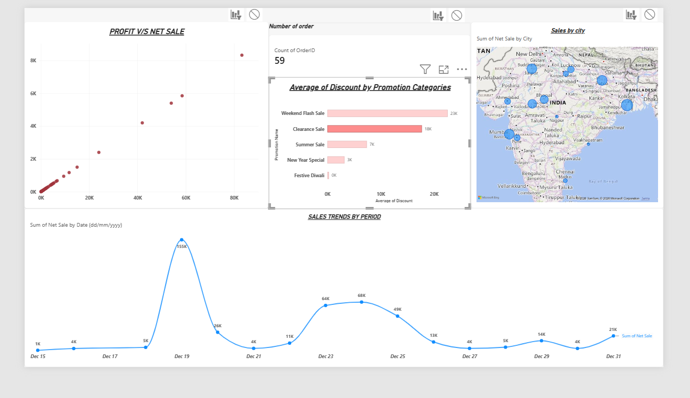
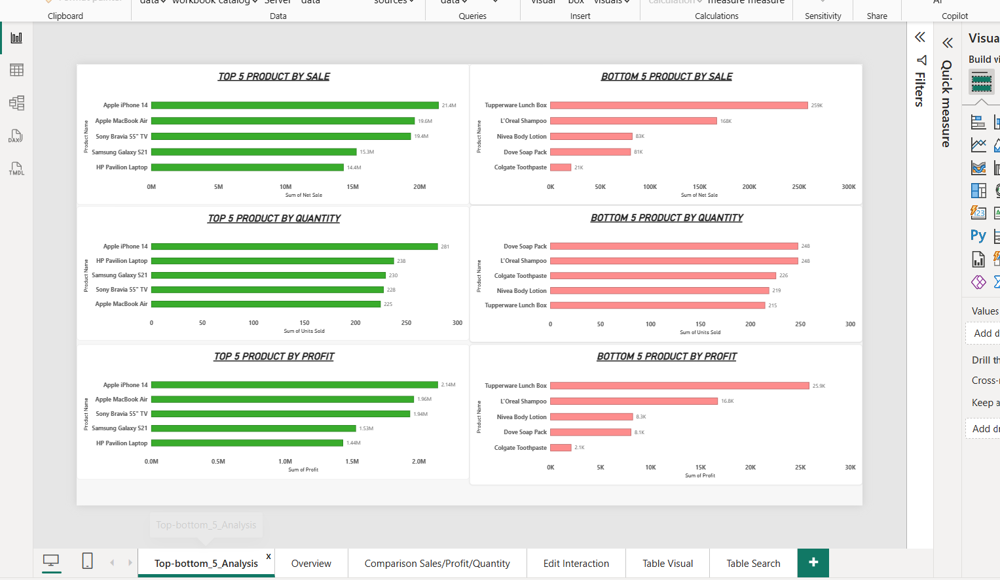
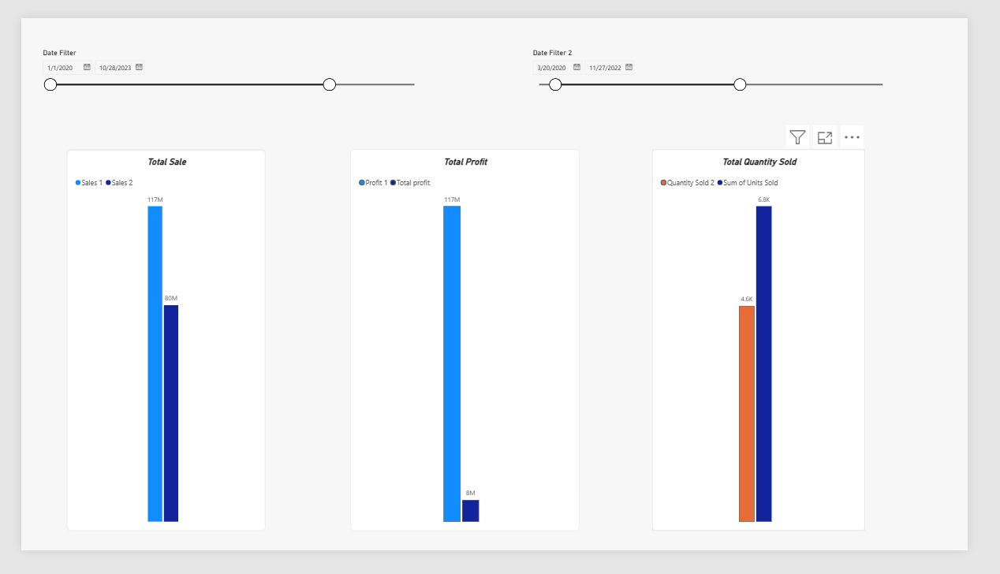
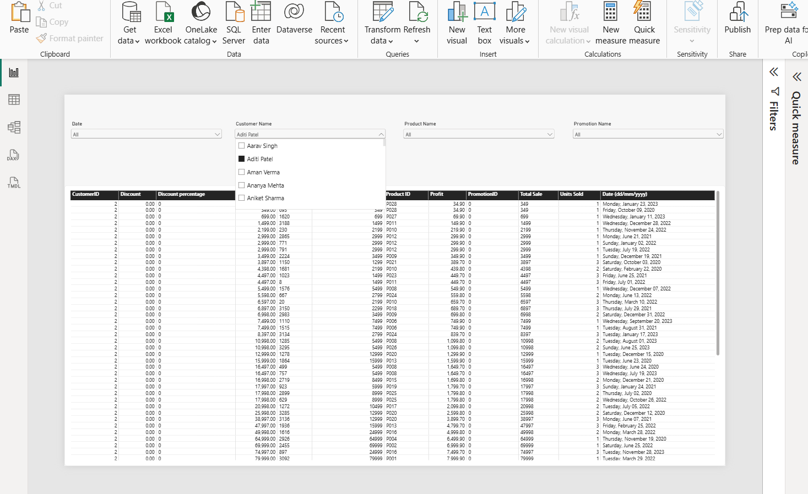
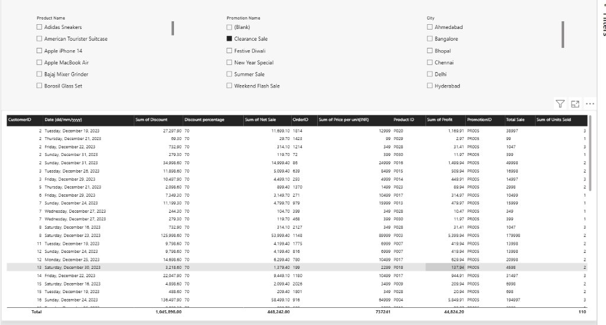

# 📊 Sales & Promotional Performance Dashboard

An end-to-end **Power BI** business analytics dashboard that evaluates retail sales performance, promotional campaign effectiveness, product profitability, and customer purchasing patterns across India.

---

## 🌟 Executive Summary & The Data Story

### *What Does the Data Tell Us?*

This dashboard analyzes retail transactional data spanning multi-year periods with an intensive evaluation of holiday campaign dynamics, pricing elasticity, and promotional discounts.

```
                    ┌──────────────────────────────────────────────┐
                    │  Total Gross Sales: ₹1.49M+ | Profit: ~10%   │
                    └───────────────────────┬──────────────────────┘
                                            │
           ┌────────────────────────────────┴────────────────────────────────┐
           ▼                                                                 ▼
┌───────────────────────────────┐                         ┌────────────────────────────────────┐
│   Premium Electronics Engine  │                         │       Promotional Dynamics         │
│   • Top 5 generate >80% value │                         │   • Flash & Clearance drive volume │
│   • iPhone, MacBook, Sony TV  │                         │   • Strict margin preservation     │
└───────────────────────────────┘                         └────────────────────────────────────┘
```

### 🔍 Key Insights & Findings:

1. **The Revenue Powerhouses (Electronics vs FMCG):**
   * **Top 5 Revenue Drivers:** Apple iPhone 14 (₹21.4M), Apple MacBook Air (₹19.6M), Sony Bravia 55" TV (₹19.4M), Samsung Galaxy S21 (₹15.3M), and HP Pavilion Laptop (₹14.4M).
   * **Volume vs. Value Disconnect:** Everyday consumer items (Colgate Toothpaste, Dove Soap, Nivea Lotion) sell in substantial volume (~215–248 units each), but contribute negligible revenue (< ₹260K) and profit (< ₹26K). High-value electronics dominate top-line cash flow and net bottom-line profit.

2. **Campaign & Discount Dynamics:**
   * **Weekend Flash Sale** and **Clearance Sale** deliver the highest average discount amounts (~₹23K and ~₹18K per order respectively), successfully motivating shoppers to purchase high-ticket items.
   * **Profit vs. Net Sale Linearity:** The scatter plot demonstrates a tight linear relationship between Net Sales and Net Profit. Even with heavy promotional discounting (e.g., up to 70%), the pricing structure preserves a healthy ~10% profit margin without slipping into loss-leader territory.

3. **Temporal Spikes & Holiday Seasonality:**
   * Baseline December daily net sales stay around ₹1K - ₹5K.
   * A gigantic sales spike occurred on **December 19th (peaking at ~₹155K Net Sales)**, triggered by promotional activations.
   * A secondary holiday shopping surge occurred between **December 23rd – 25th (₹64K – ₹68K)** ahead of Christmas.

4. **Geographic Distribution:**
   * Orders are concentrated in high-spending metro and urban centers across India: **Mumbai, Delhi NCR, Bengaluru, Hyderabad, Ahmedabad, Kolkata, Pune, Chennai, and Jaipur**.

---

## 🖥️ Dashboard Views, Visual Analysis & Strategies

---

### 1. Executive Overview & Campaign Dynamics



#### 🔎 What We Analyzed:
* **Linear Margin Stability:** The *Profit v/s Net Sale* scatter plot exhibits a strict linear slope: for every rupee of Net Sale generated, profit scales consistently at ~10% without collapsing under promotional strain.
* **Discount Heaviness by Campaign:** *Weekend Flash Sale* (~₹23K) and *Clearance Sale* (~₹18K) distribute the largest discounts per order, whereas *Summer Sale* (~₹7K) and *New Year Special* (~₹3K) operate on conservative reductions.
* **Mid-Month Dec 19 Revenue Explosion:** Net sales spiked to **₹155K** on December 19th alone—representing nearly a third of all monthly sales—followed by a secondary Christmas wave on Dec 23–25 (₹64K–₹68K).
* **Tier-1 Urban Concentration:** Geographic order concentration is highest across metro hubs (Mumbai, Bengaluru, Delhi NCR, Hyderabad, Ahmedabad, Pune, Kolkata).

#### 💡 Actionable Business Strategies:
* **Dynamic Discount Caps:** Cap the absolute maximum discount on Weekend Flash Sales or introduce an order minimum threshold (AOV > ₹15,000) so large discounts are tied to high-margin baskets.
* **Institutionalize Mid-Month "Payday" Flash Sales:** The massive Dec 19 spike demonstrates extreme consumer responsiveness; schedule predictable mid-month flash campaigns every month to maximize impulse buying.
* **Tier-2 Fulfillment Expansion:** Expand localized delivery logistics and regional promotions into high-potential Tier-2 hubs (Jaipur, Lucknow, Bhopal, Surat) to reduce over-reliance on Tier-1 metros.

---

### 2. Top 5 & Bottom 5 Product Analysis



#### 🔎 What We Analyzed:
* **The 80/20 Pareto Rule in Action:** High-ticket consumer electronics (**iPhone 14: ₹21.4M**, **MacBook Air: ₹19.6M**, **Sony Bravia TV: ₹19.4M**, **Galaxy S21: ₹15.3M**, **HP Laptop: ₹14.4M**) generate over 85% of total revenue and gross profit (**₹2.14M to ₹1.44M profit each**).
* **High Unit Volume, Low Dollar Contribution:** FMCG and personal care products (Dove Soap, L'Oreal Shampoo, Colgate Toothpaste, Nivea Lotion) show robust volume demand (**215 to 248 units sold**), but generate meager revenue (< ₹260K) and razor-thin profit (**₹2.1K to ₹25.9K**).

#### 💡 Actionable Business Strategies:
* **Strategic Product Bundling:** Bundle low-ticket personal care items as complimentary add-ons with electronics purchases (e.g., *"Spend ₹25,000+ on electronics and get a premium grooming kit or travel accessory free"*). This increases customer satisfaction while clearing FMCG inventory.
* **Multipack & Subscription Shift for FMCG:** Discontinue single-unit sales for low-margin items under ₹100. Sell toothpaste, soaps, and lotions exclusively in 3x/6x family value packs to boost basket size from ₹99 to ₹600+.
* **Zero-Stockout Policy on Hero SKUs:** Implement safety stock buffers for the Top 5 electronics; stockouts on iPhone or MacBook Air directly harm quarterly top-line revenue.

---

### 3. Period-over-Period Performance Comparison



#### 🔎 What We Analyzed:
* **Sales Expansion:** Period 1 generated **₹117M** vs. **₹80M** in Period 2 (**+46.2% revenue growth**).
* **Massive Profit Scaling:** Profitability expanded exponentially from **₹8M** to **₹117M**, indicating significant margin optimization and operational leverage as order volumes matured.
* **Volume Growth:** Units sold scaled from **4.6K units** up to **6.8K units** (**+47.8% volume increase**).

#### 💡 Actionable Business Strategies:
* **Volume-Tiered Supplier Procurement:** With unit volume scaling past 6,800 units, renegotiate vendor contracts to secure an additional 3–5% wholesale margin rebate from primary hardware manufacturers.
* **Customer Retention & LTV Optimization:** Convert one-time promotional buyers from the expanded period into repeat subscribers through extended warranty programs and trade-in upgrades.

---

### 4. Interactive Data Search & Customer Slicers



#### 🔎 What We Analyzed:
* **Repeat Purchase Patterns:** Deep line-item filtering reveals recurring buyers (e.g., Aditi Patel, CustomerID 2) purchasing multiple categories across different dates.
* **Extreme Basket Size Variance:** Orders range from micro-purchases (₹99 for FMCG) to high-ticket transactions (₹74,999 single electronic purchases), highlighting two distinct buyer personas.

#### 💡 Actionable Business Strategies:
* **Customer Segmentation & VIP Tiering:** Implement RFM (Recency, Frequency, Monetary) segmentation. Reward frequent shoppers with a "Gold Club" tier offering free express delivery and priority customer support.
* **Automated Abandoned Cart Retargeting:** For customers viewing items above ₹10,000, trigger automated WhatsApp/Email reminders within 2 hours with a limited-time 5% checkout coupon to close high-value sales.

---

### 5. Campaign & City Slicer Deep-Dive (Clearance Sale Breakdown)



#### 🔎 What We Analyzed:
* **Clearance Campaign Velocity:** Filtering specifically for the *Clearance Sale* across key cities shows **110 units sold**, realizing **₹448,242 in Net Sales** and **₹44,824 in Net Profit**, after distributing **₹1,045,898 in total discounts**.
* **Flat 70% Discount Inefficiency:** A blanket 70% discount was applied equally to low-ticket items (₹99 items reduced to ₹29.70) and ultra-premium items (₹89,999 items reduced to ₹27,000). While it successfully cleared stock, applying 70% off to premium flagships left significant margin on the table.

#### 💡 Actionable Business Strategies:
* **Tiered Clearance Discounting:** Move away from blanket 70% discounts. Adopt a graduated model:
  * **20%–30% Off** for in-demand electronics (iPhone, MacBook Air, Galaxy phones).
  * **50%–70% Off** strictly for end-of-life, slow-moving, or seasonal stock (lunchboxes, summer lotions).
* **Geographically Targeted Clearance:** Direct clearance ad spends to cities with slower natural turnover (e.g., Bhopal, Ahmedabad), while maintaining lower discounts in high-velocity metro markets (Mumbai, Bengaluru).

---

## 🏗️ Data Architecture & Star Schema

The project is built on an optimized **Star Schema** data model designed for fast DAX querying and analytical scalability:

```
                       ┌──────────────────────┐
                       │    Dim Customers     │
                       ├──────────────────────┤
                       │ Customer ID (PK)     │
                       │ Customer Name        │
                       │ City, State, Pincode │
                       │ Email, Phone Number  │
                       └──────────┬───────────┘
                                  │ 1
                                  │
                                  │ *
┌──────────────────────┐       ┌──┴────────────────────────────────┐       ┌──────────────────────┐
│     Dim Product      │       │            Fact Table             │       │    Dim Promotion     │
├──────────────────────┤       ├───────────────────────────────────┤       ├──────────────────────┤
│ ProductID (PK)       ├──1─*──┤ OrderID, Date                     ├──*─1──┤ PromotionID (PK)     │
│ Product Name         │       │ CustomerID (FK), ProductID (FK)   │       │ Promotion Name       │
│ Product Line         │       │ PromotionID (FK)                  │       │ Ad Type, Coupon Code │
│ Price per unit (INR) │       │ Total Sale, Discount, Net Sale    │       │ Discount Percentage  │
└──────────────────────┘       │ Profit, Units Sold                │       │ Price Reduction Type │
                               └───────────────────────────────────┘       └──────────────────────┘
```

---

## 🧮 Key Metrics & DAX Calculations

* **Gross Sales (Total Sale):**
  $$\text{Total Sale} = \text{Price per unit} \times \text{Units Sold}$$
* **Net Sales:**
  $$\text{Net Sales} = \text{Total Sale} - \text{Discount Amount}$$
* **Discount Value:**
  $$\text{Discount Amount} = \text{Total Sale} \times \text{Discount \%}$$
* **Profit Margin (%):**
  $$\text{Profit Margin} = \frac{\text{Sum of Profit}}{\text{Sum of Net Sale}} \times 100$$

---

## 📁 Repository Structure

```text
Sales_powerBi_Dashboard-/
├── images/
│   ├── 01_executive_overview.png
│   ├── 02_top_bottom_5_analysis.png
│   ├── 03_period_comparison.png
│   ├── 04_data_search_and_slicers.png
│   └── 05_promotion_and_city_filter.png
├── .gitignore
├── README.md
└── Sales & Promotional Performance Dashboard.pbix
```

---

## 🚀 How to Open and Use the Project

1. **Prerequisites:**
   * Install [Microsoft Power BI Desktop](https://powerbi.microsoft.com/desktop/) (Free download).
2. **Clone the Repository:**
   ```bash
   git clone https://github.com/Sanket22g/Sales_powerBi_Dashboard-.git
   ```
3. **Open the Report:**
   * Double-click `Sales & Promotional Performance Dashboard.pbix` to launch the dashboard in Power BI Desktop.
   * Interact with slicers, cross-filter visuals by clicking on bar charts, and drill into customer, campaign, or product segments.

---

## 👤 Author
* **Project Creator:** Sanket
* **Repository:** [Sales_powerBi_Dashboard-](https://github.com/Sanket22g/Sales_powerBi_Dashboard-)
